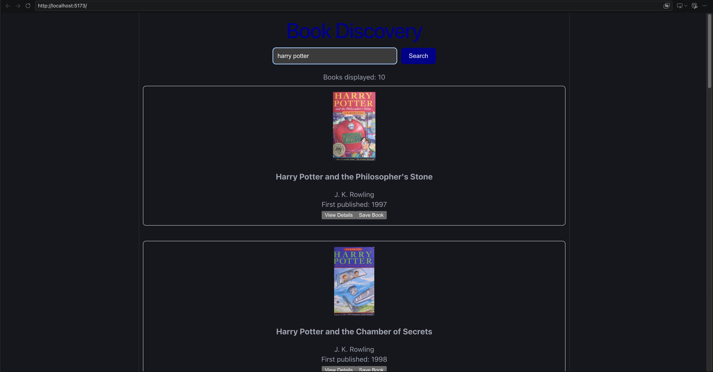
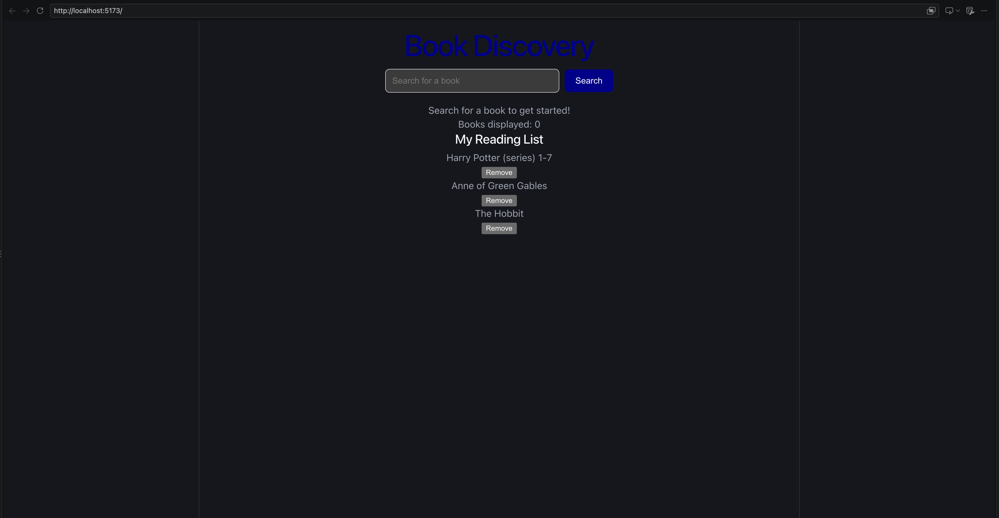

# Book Discovery

A full-stack app for finding books and managing a personal reading list. Built with React, Flask, and SQLite, using the Open Library API for book searches.

## Features

- Search for books by title, author, or keywords.
- View book covers, authors, publication years, and details.
- Save books to a reading list.
- Prevent duplicate saved books.
- Remove books from the reading list.
- Keep saved books after refreshing through SQLite storage.
- Display loading, empty-list, and error messages.

## Technologies

- Frontend: React, JavaScript, CSS, Vite
- Backend: Python, Flask, Flask-CORS
- Database: SQLite
- Book data: Open Library API

## Run Locally

Install Python 3 and Node.js with npm before starting.

Run the following commands from the project's root folder.

### 1. Start the backend

Create and activate a virtual environment:

```bash
python3 -m venv backend/.venv
source backend/.venv/bin/activate
```

Install dependencies and start Flask:

```bash
python -m pip install -r backend/requirements.txt
python backend/app.py
```

The backend runs at `http://127.0.0.1:5001`.

The SQLite database and its table are created automatically when the backend starts.

### 2. Start the frontend

Open a second terminal in the project's root folder:

```bash
npm install
npm run dev
```

Open the local URL printed by Vite, normally `http://localhost:5173`.

The backend's CORS configuration must allow the frontend's address.

## API Endpoints

| Method | Endpoint | Purpose |
| --- | --- | --- |
| GET | /api/books | Retrieve saved books |
| POST | /api/books | Save a book |
| DELETE | /api/books/<book_id> | Delete a saved book |

## Current Scope

This version runs locally and uses one shared reading list. User accounts and separate reading lists per user are not implemented.

## Screenshot


